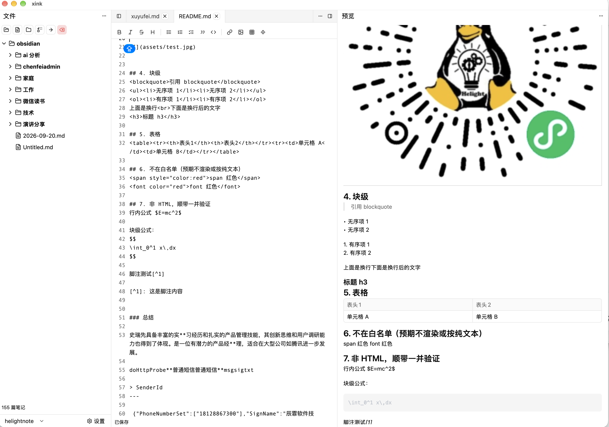

# xink

基于 [GPUI](https://gpui.rs) 的本地优先 Markdown 笔记桌面应用，目标是提供 Obsidian 的基础能力：
**目录管理**、**Markdown 编辑**、**实时预览**，以及 **JSON / YAML / TOML 数据文件的编辑与格式化预览**，
并可选地接入 **AI 协助**（默认关闭，未启用时不发起任何网络请求）。

核心原则：**笔记就是磁盘上普通的 `.md` 文件**——不需要账号，不上传云端，不转换格式，
不引入数据库。索引、缓存、配置都是可随时重建的派生数据。

- 需求规格：[`docs/REQUIREMENTS.md`](docs/REQUIREMENTS.md)
- 技术设计：[`docs/DESIGN.md`](docs/DESIGN.md)

---

## 功能总览

### 1. 库与目录管理

| 功能 | 说明 |
|---|---|
| 打开文件夹作为库 | `Cmd+O` 选择任意文件夹；库根就是普通目录，可被 Obsidian 直接打开 |
| 多库管理 | 独立「库管理」窗口：新增、切换、改名、重新定位（路径失效时重选目录且 id 不变）、删除（仅移除记录，**绝不删磁盘**）；每个库带状态徽标（当前库 / 失效 / 重复 / 嵌套） |
| 目录树浏览 | 递归扫描，目录在前、同层按名称排序，库根默认展开 |
| 文件类型图标 | 目录 / Markdown / 图片 / 代码 / 数据文件 / 压缩包 / 表格 / 其他 |
| 默认可见范围 | 可编辑文本（`.md`、`.json`、`.yaml`、`.yml`、`.toml`）+ 图片；开启"显示全部"后其他类型也进树 |
| 始终忽略 | `.git`、`node_modules`、`target`、`.DS_Store`、`*.md.tmp` 以及（未开"显示全部"时的）点开头隐藏项 |
| 新建 | 新建笔记（自动补 `.md`、重名报错）、新建目录 |
| 重命名 / 删除 / 移动 | 工具栏按钮、右键菜单、`F2`；禁止删除库根与库外路径 |
| 树内拖拽移动 | 拖拽带文件名浮层、悬停高亮落点；禁止移入自身或子目录、同名自动改名不覆盖；跨设备走"复制 + 大小校验 + 删源"，大小不一致保留源文件并报错 |
| 外部导入 | 从访达拖入文件/目录即复制进库；也支持复制模式/移动模式的批量导入 |
| 粘贴 | 访达复制的文件导入，或截图直接写成 `pasted-<时间戳>.<ext>` |
| 右键菜单 | 重命名、删除、在此新建笔记/文件夹、移动到…、复制相对路径、复制为 Markdown 链接、插入到当前笔记、粘贴到此目录 |
| 自动刷新 | `notify` 递归监听库目录；仅"新建/删除"才重扫整棵树，"内容修改"不触发重扫 |

### 2. 笔记编辑

| 功能 | 说明 |
|---|---|
| 源码模式编辑 | 基于代码编辑控件（行号可开关），Rope 存储，不逐字符拷贝全文 |
| 格式工具栏 | 13 个按钮：加粗、斜体、删除线、标题、无序列表、有序列表、任务列表、引用、代码块、链接、图片、表格、分割线。有选区则包裹，无选区则插入占位并把光标放中间 |
| 自动保存 | 停止输入 **300ms**（可在 200–60000ms 间配置）后防抖写入；每次输入覆盖上一个任务，旧任务自动取消 |
| 立即保存 | `Cmd+S` 绕过防抖立刻写盘 |
| 原子写盘 | 同目录写 `.tmp` 再 `rename`，崩溃绝不产生半截文件；失败清理临时文件 |
| 脏标记 | 未保存时标签标题显示 `●` |
| 外部修改处理 | 磁盘文件被外部改动：无未保存修改则自动重载；有未保存修改则保留你的内容并提示，绝不静默覆盖 |
| 多标签 | 同一文件只会有一个标签（重复打开只激活已有标签）；标签按打开顺序排列，每个标签独立关闭按钮 |
| 最后一个标签 | 关闭最后一个标签不清空编辑区，而是置为空白占位页，保证下次打开有落点 |
| 会话恢复 | 重启后恢复上次的标签顺序与活动标签（按当前库过滤，失效路径自动剔除） |
| 缩进配置 | Tab / 空格、缩进宽度 1–16，改设置立即生效 |

### 3. 预览

| 功能 | 说明 |
|---|---|
| Markdown 渲染 | 标题、粗斜体、删除线、列表、任务列表、引用、表格、代码块、分隔线、链接、图片 |
| 图片预览模式 | 点击笔记里的图片或目录树中的图片文件，在**同一个预览面板**显示（不新开窗口）；切换/编辑笔记时自动退出 |
| 本地图片内联 | 相对路径 / 绝对路径 / `file://` 本地图自动转 base64 data URL；带缓存（按路径 + mtime + 大小），单图上限 5MB |
| 图片显示方式 | 适应宽度（20–100% 可调）或隐藏（退化为纯文本链接） |
| 代码块高亮 | syntect 默认语法全集，按语言名或扩展名查找，找不到回退纯文本；结果带缓存（256 条上限） |
| 高亮主题 | 可从 syntect 全部主题中选择；默认「跟随主题」，随明暗自动切换深浅 |
| 滚动同步 | 编辑区与预览双向同步，逐帧轮询，带回显吸收防死循环；可在设置里关闭；图片模式不参与 |
| 版面密度 | 紧凑 / 适中 / 宽松三档（影响留白、段间距、标题缩放、正文最大宽度），也可单独设最大宽度 |
| 链接点击 | 应用内打开（尝试作为笔记打开）或交给系统浏览器，可配置 |
| 防御性预处理 | 连续分隔线之间自动补空行，规避底层 Markdown 解析器 panic 导致应用退出 |
| 向左伸展 | 预览区标题**最左侧**的按钮：点击后预览铺满窗口（编辑区与目录树被一并遮住），再点恢复三栏；状态不持久化，重启回三栏 |

### 4. 数据文件编辑（JSON / YAML / TOML）

| 功能 | 说明 |
|---|---|
| 可打开的类型 | `.json`、`.yaml`、`.yml`、`.toml` |
| 编辑区语法高亮 | 按语言高亮（json / yaml / toml） |
| 预览显示格式化结果 | 预览区展示 pretty-print 之后的内容，并带代码块高亮 |
| 格式校验 | 实时校验；非法内容给出**行 / 列 + 原因**，编辑区打波浪线标记，预览顶部也有红字提示 |
| 错误不阻断保存 | 校验错误不会阻止你保存（xink 是编辑器，不是 IDE） |
| 缩进宽度 | JSON 缩进 1–8 空格可配置 |
| 大文件保护 | 超过体积上限（默认 1MB，可配置，0 表示不限制）就跳过格式化、直接显示原文 |
| **格式化只进预览** | **程序绝不改写你的文件**。YAML 往返会丢失注释，所以格式化结果只用于预览，写盘永远是你输入的原文 |

### 5. 导航与结构（P1）

| 功能 | 快捷键 | 说明 |
|---|---|---|
| 命令面板 | `Cmd+P` | 模糊搜索文件名快速打开；命中已打开的笔记只激活，不产生第二个标签 |
| 全文搜索 | `Cmd+Shift+F` | 检索笔记正文，结果带行号与上下文，点击跳到命中行（后台检索、输入防抖 200ms） |
| 大纲 | 右侧按钮条 | 按层级展示当前笔记标题，点击**定位到该标题所在行**；跳转后抽屉保持打开，可连续跳 |
| 双链 | 输入 `[[` | 预览里 `[[笔记名]]` 可点击跳转；输入 `[[` 弹出候选补全 |
| 反链 | 右侧按钮条 | 列出引用了当前笔记的笔记与行号，点击跳转 |
| 标签 | 右侧按钮条 | 聚合库内 `#tag` 与计数，点击展开该标签下的笔记 |
| 明暗主题切换 | `Cmd+Shift+L` | 跟随系统时按一次切到相反外观，之后在浅 / 深之间往返 |
| Markdown 快捷键 | `Cmd+B` / `Cmd+I` / `Cmd+Shift+X` / `Cmd+E` / `Cmd+K` | 加粗 / 斜体 / 删除线 / 行内代码 / 链接 |

目录树刷新采用**保状态合并**：删除、新建、重命名后只重建受影响的节点，
其余节点的展开状态、选中项与滚动位置都保持不变（详见
`docs/file-tree/file-tree-incremental-refresh-design.md`）。

### 6. AI 协助（可选，默认关闭）

> AI 是**可选能力**：未启用时应用行为与关闭前完全一致，**不会发起任何网络请求**。
> 开关与全部配置都在「设置 → AI」，改动即时生效、可随时关掉。
> 设计见 `docs/ai/ai-assistant-design.md`。

| 能力 | 说明 |
|---|---|
| 对话条 | 编辑器下方的对话区（`Cmd+Shift+A` 开关）；气泡布局，会话**按笔记落盘**（`ai_sessions.json`），换笔记自动切换、**重启后仍在**，正文可复制，工具调用过程分块折叠 |
| 结果落地 | 生成后给三个落法：**插入到光标处**（对话默认）、**替换原文**（删掉整篇换成生成结果，需二次确认）、**不采用**；改动前一律先写快照 |
| 快捷动作 | 8 个内置动作：润色、扩写、精简、翻译、改写标题、生成摘要、生成标签、续写；命令面板里也能用 `AI:` 前缀唤起 |
| 修订评审 | AI **不直接改文件**：先在编辑区内做行级 diff 对照，按修改块**逐块「接受 / 拒绝」**，确认后才落盘 |
| 改前快照 | 接受改动前把原文另存到应用数据目录的 `ai-history/`（上限 200 份，超了删最旧的）——项目没有撤销栈，这是人工回退的兜底 |
| 模型后端 | 两类：Ollama（native `/api/chat`）与 OpenAI 兼容端点；`base_url` 整体可配，换厂商即换地址 |
| 模型管理 | 多个模型条目 + 默认模型；单个模型可「连接测试」，测通不通、支不支持工具调用、耗时多少 |
| 密钥 | 默认存 macOS Keychain；也支持环境变量 `XINK_AI_API_KEY`，或（用户显式选择）明文写入 `config.json` |
| Agent Skills | 用 `SKILL.md` 定义自己的动作，框架负责发现、执行与启停；设置里可整体开关 |
| 库级批量任务 | 「计划面板」把整库范围的整理（如批量打标签）拆成任务，批量执行并支持中断恢复 |

**边界**（与项目铁律一致）：

- **AI 不直接改磁盘**：所有修改经 diff 预览与逐块确认，改前留快照。
- **领域层可测**：provider 通信、SSE 解析、prompt 组装、diff 计算都在 `core/ai/`，不碰 UI 类型。
- **未启用绝不静默联网**。

### 7. 界面与外观



| 功能 | 说明 |
|---|---|
| 三栏布局 | 左文件树 / 中编辑 / 右侧 dock（预览），基于可拖拽、可停靠的 DockArea；默认左 260px、右 420px |
| 右侧按钮条 | 最右侧浮层（不占布局宽度），上下排列「大纲 / 反链 / 标签」三个按钮；点击即从右侧滑出**半透明抽屉**（宽 260px、上下撑满窗口），内容都在抽屉里展示，右上角有收回按钮，点遮罩或 `Esc` 也可收起。详见 `docs/preview/right-rail-drawer-design.md` |
| 布局持久化 | 布局写入 `layout.json`（带版本号），结构变更时自动重建默认布局 |
| 主题 | 跟随系统 / 浅色 / 深色；跟随系统时随系统外观变化实时切换 |
| 字体与图标 | 目录树、编辑区、预览区各自可设字体族 / 字号 / 行高 / 字重；目录树图标大小 12–48px |

### 8. 设置

独立设置窗口（单例），四个分类多个分组，改动**即时生效并落盘**：

| 分类 | 分组 | 主要设置项 |
|---|---|---|
| 基本 | 外观 | 主题、界面语言 |
| 基本 | 目录树 | 图标大小、字体、是否显示全部文件 |
| 编辑器 | 编辑行为 | 自动保存开关与延迟、缩进、行号、拼写检查 |
| 编辑器 | 字体与排版 | 字体族 / 字号 / 行高 / 字重、配色 |
| 编辑器 | 数据文件 | JSON 缩进宽度、格式化体积上限 |
| 编辑器 | 快捷键 | 每个动作一条，可覆盖默认键位；留空即用默认（**重启后生效**） |
| AI | 连接 | 启用开关、Ollama 地址与 `keep_alive` / `num_ctx` |
| AI | 生成 | 超时、上下文字符上限、最大步数、输出语言 |
| AI | 扩展 | Skills 开关；模型条目管理与连接测试 |
| 预览 | 渲染 | 代码高亮主题、图片显示方式与宽度、链接打开方式 |
| 预览 | 排版 | 字体、版面密度、正文最大宽度 |
| 预览 | 同步 | 编辑区与预览滚动同步 |

附加能力：设置项搜索（输入即过滤、回车跳首个命中）、单项重置为默认、配置导入 / 导出 / 恢复全部默认；
对已配置但尚未生效的项会标注「⚠ 暂未生效」。

> 已知尚未生效的配置项：**界面语言**（文案未本地化）、**拼写检查**（引擎未接入）、
> **编辑区配色**（跟随主题，未独立适配）。

### 9. 持久化与容错

应用状态统一放在应用数据目录（由 `dirs::data_dir()` 决定）：

| 平台 | 路径 |
|---|---|
| macOS | `~/Library/Application Support/xink/` |
| Linux | `~/.local/share/xink/` |
| Windows | `%APPDATA%\xink\` |

```
├── config.json        # 用户配置（基本 / 编辑器 / 预览 / AI）
├── layout.json        # Dock 布局（面板位置与大小）
├── open_notes.json    # 已打开的标签（顺序 + 当前活动标签）
├── vaults.json        # 多库注册表与当前选择
├── vault.json         # 旧版单库记录（仅作迁移来源）
├── ai_sessions.json   # AI 会话历史（按笔记分组）
├── ai-history/        # AI 改动前的原文快照（上限 200 份）
└── xink.pid           # 单实例锁
```

- **笔记正文不在这里**，始终是库目录里普通的 `.md` 文件；这里都是可重建的派生状态。
- 删除整个目录只会丢失偏好与界面状态，**不会丢失任何笔记**。
- 文件缺失或 JSON 损坏一律回落默认值继续启动，不会崩在启动阶段。
- 旧版本配置文件缺字段自动补齐；已移除的旧枚举值有兜底，不会导致整个配置解析失败。

### 10. 其他

- **单实例保护**：PID 文件 + 进程探测，重复启动直接退出（避免多个渲染窗口与监听线程）。
- **外部变更监听**：`notify` 递归监听 + 无界通道，区分"创建 / 删除 / 修改"三类事件。

---

## 快捷键

| 快捷键 | 作用 |
|---|---|
| `Cmd+O` | 打开文件夹作为库 |
| `Cmd+N` | 新建笔记 |
| `Cmd+S` | 立即保存当前笔记 |
| `Ctrl+W` | 关闭当前笔记标签 |
| `F2` | 重命名（焦点在文件树时生效） |
| `Cmd+Shift+A` | 打开 / 关闭编辑器下方的 AI 对话条 |
| `Cmd+,` | 打开设置 |

> 全部键位都可在「设置 → 编辑器 → 快捷键」里逐条覆盖，留空即回默认；**改动重启后生效**。
> 「新建文件夹」「删除」默认不绑键位，需要的话在设置里指定即可。

---

## 尚未实现 / 决定不做

以下功能**不可用**，避免误以为已经支持：

| 功能 | 状态 |
|---|---|
| 跨库检索 | **决定不做**（2026-10-20）：搜索与双链只覆盖当前库，切库即切换范围。见 `docs/vault/multi-vault-design.md` |
| 拼写检查 | **决定不做**（2026-10-20）：框架无拼写能力、自研需新依赖与词典，配置项已移除。见 `docs/editor/editor-features-analysis.md` §4 |
| 视频播放 | **已尝试并放弃**：Spike 阶段解码 / 渲染 / 音频 / 音画同步全部验证通过，但接进应用后画面始终出不来，代码与依赖已清理。完整复盘在 `docs/video-playback-design.md`（该文件位于 `spike/video-playback` 分支，未合入 main） |
| PDF 预览 | 未立项：`REQUIREMENTS.md` 列为 P2 非目标 |

> 双链、反链、标签、全文搜索、大纲、命令面板均已实现（P1 已交付），不再属于此列。

---

## 构建与运行

### 前置条件

**macOS**（GPUI 使用 Metal）：安装 Xcode 命令行工具即可。

```bash
xcode-select --install
```

> 已验证：仅装 Command Line Tools 也能编译并正常运行（Metal 渲染正常）。
> 若要做打包签名，还需要 `iconutil` / `sips` / `hdiutil`（由命令行工具提供）以及 `pkgbuild`。

### 常用命令

```bash
cargo run                 # 运行
cargo test                # 运行全部测试（含 core 与 ui 的单元测试）
cargo clippy --all-targets
cargo fmt
```

首次编译会拉取并构建 blade-graphics / tree-sitter / resvg 等重依赖，耗时较长，属正常现象。

---

## 打包（macOS）

打包由 `scripts/build_macos.sh` 完成：**编译 → 生成 `.icns` 图标 → 组装 `.app` → 签名 → 打包 `.dmg` / `.pkg`**。

```bash
./scripts/build_macos.sh               # 编译 release，产出 .app + .dmg（最常用）
./scripts/build_macos.sh --pkg         # 额外产出 .pkg 安装器
./scripts/build_macos.sh --no-dmg      # 只产出 .app
./scripts/build_macos.sh --skip-build  # 跳过编译，用已有 target 产物重新打包
./scripts/build_macos.sh -h            # 查看用法
```

产物统一输出到 `build/`（版本号取自 `Cargo.toml`，无需另外维护）：

| 产物 | 说明 |
|---|---|
| `build/xink.app` | 应用 Bundle |
| `build/xink-<version>.dmg` | 拖拽安装盘（默认产出） |
| `build/xink-<version>.pkg` | 安装器（加 `--pkg`） |

可用环境变量覆盖默认值：

```bash
PROFILE=debug ./scripts/build_macos.sh --skip-build    # 用 debug 产物试跑打包流程
ICON_SRC=resources/other.png ./scripts/build_macos.sh  # 指定其它图标源
VERSION=0.2.0 ./scripts/build_macos.sh                 # 覆盖版本号
```

| 变量 | 默认值 |
|---|---|
| `APP_NAME` | `xink` |
| `BUNDLE_ID` | `com.helight.xink` |
| `VERSION` | 取自 `Cargo.toml` |
| `ICON_SRC` | `resources/AppIcon.png` |
| `PROFILE` | `release` |
| `MIN_MACOS` | `11.0` |
| `BUILD_DIR` | `./build` |

注意事项：

- 图标由 `sips` 生成多尺寸 `iconset` 再转 `.icns`。
- 脚本会**校验图标资源确实内嵌进二进制**（在产物里检索 SVG），未内嵌则直接失败——
  否则打出的包在本机正常、拷到别的机器就图标全丢。
- 签名默认是 ad-hoc（`codesign --sign -`），仅保证本地可运行；
  分发前需用 Developer ID 重新签名（脚本结束时会打印对应命令）。

---

## 项目结构

```
src/
├── main.rs        启动入口：单实例检查、快捷键绑定、面板重建工厂
├── app.rs         全局状态 AppState、DockArea 布局、主题、配置更新入口
├── actions.rs     快捷键动作定义
├── core/          领域层（纯业务，不含 UI，可独立测试）
│   ├── vault.rs      库扫描、增删改移、多库注册表
│   ├── note.rs       笔记加载/保存、原子写盘、外部修改检测
│   ├── markdown.rs   预览预处理（图片内联、防御性 sanitize）
│   ├── datafile.rs   JSON / YAML / TOML 解析、格式化、校验
│   ├── media.rs      文件类型判定（唯一判据来源）
│   ├── highlight.rs  代码块语法高亮（syntect）
│   ├── config.rs     配置项定义、区间校正、持久化
│   ├── watcher.rs    外部变更监听
│   ├── session.rs    标签去重与恢复规则
│   ├── keymap.rs     默认键位表与覆盖值的校验
│   ├── fs.rs         文件复制/移动/删除/导入
│   └── ai/          AI 领域层（不碰 UI 类型，可独立测试）
│       ├── openai.rs / ollama.rs    两类 provider 与流式（SSE / NDJSON）解析
│       ├── agent_loop.rs / tools.rs  Agent 循环与工具调用
│       ├── diff.rs / patch.rs / verify.rs  改动计算、应用与校验
│       └── snapshot.rs / tasks.rs / skills.rs  改前快照、库级任务、SKILL.md
├── ui/            视图层
│   ├── file_tree.rs     文件树面板
│   ├── editor.rs        编辑面板（含 AI 对话条与修订评审）
│   ├── preview.rs       预览面板
│   ├── settings.rs      设置窗口
│   ├── rail.rs          最右侧按钮条（大纲 / 反链 / 标签）
│   ├── drawer.rs        右侧半透明抽屉（承载上面三个面板）
│   ├── tabs.rs          标签注册与"打开笔记"唯一入口
│   ├── vault_manager.rs 库管理窗口
│   └── ai/
│       └── plan.rs      库级任务的计划面板
└── state/         持久化
    ├── workspace.rs      配置 / 布局 / 标签 / 库列表的读写
    └── single_instance.rs 单实例锁
```

测试代码放在仓库根的 `tests/`，**目录结构镜像 `src/`**（如 `src/core/datafile.rs` 的测试在
`tests/core/datafile.rs`，由源文件末尾的 `#[path]` 挂载）。详见 [`docs/TESTS.md`](docs/TESTS.md)。

分层铁律：`ui → core` 单向依赖，`core/` 不得出现任何 UI 组件类型或布局样式。

---

## 文档索引

完整索引（57 份文档的状态、对应模块、已知缺口）见 [`docs/INDEX.md`](docs/INDEX.md)。

| 文档 | 内容 |
|---|---|
| [`docs/INDEX.md`](docs/INDEX.md) | **文档总索引**（状态 / 对应模块 / 已知缺口） |
| [`docs/REQUIREMENTS.md`](docs/REQUIREMENTS.md) | 需求规格（R1–R13） |
| [`docs/DESIGN.md`](docs/DESIGN.md) | 技术设计 |
| [`docs/TESTS.md`](docs/TESTS.md) | 测试代码的组织方式与命令 |
| [`docs/editor/json-yaml-editing-requirements.md`](docs/editor/json-yaml-editing-requirements.md) | 数据文件编辑需求（R13） |
| [`docs/editor/json-yaml-editing-design.md`](docs/editor/json-yaml-editing-design.md) | 数据文件编辑设计 |
| [`docs/vault/multi-vault-design.md`](docs/vault/multi-vault-design.md) | 多库机制设计 |
| [`docs/preview/preview-layout-design.md`](docs/preview/preview-layout-design.md) | 预览版面设计 |
| [`docs/ai/ai-assistant-requirements.md`](docs/ai/ai-assistant-requirements.md) | AI 协助需求（R14） |
| [`docs/ai/ai-assistant-design.md`](docs/ai/ai-assistant-design.md) | AI 协助设计（provider / agent loop / 修订评审 / 快照） |
| [`docs/preview-extend-design.md`](docs/preview-extend-design.md) | 预览区向左伸展的设计与方案取舍 |
| [`docs/ACCEPTANCE.md`](docs/ACCEPTANCE.md) | 人工验收清单（只能靠跑起来看的项） |
| `.codebuddy/rules/` | 开发铁律（开工前必读，含会导致编译失败的硬约束） |

---

## 开发约定

项目级 AI 开发规则与技能位于 `.codebuddy/`：

```
.codebuddy/rules/    开发铁律（技术栈、分层架构、编码规范、领域规则、先设计后开发）
.codebuddy/skills/   开发技能（GPUI 桌面开发、本应用开发 SOP）
```

开工前请先阅读 [`.codebuddy/rules/`](.codebuddy/rules/)，其中有会导致编译失败或架构腐化的硬约束。

---

## TODO

需要优化 AI 功能：将快捷功能精简为润色、精简、翻译、改写标题、生成摘要、生成标签这几项。设计可配置化机制，支持新增快捷功能，每项快捷功能可配置对应的提示词，并在提交模型请求时携带该提示词。

## 许可

MIT（见 `Cargo.toml` 的 `license` 字段）。
